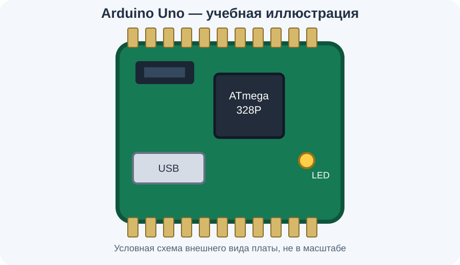
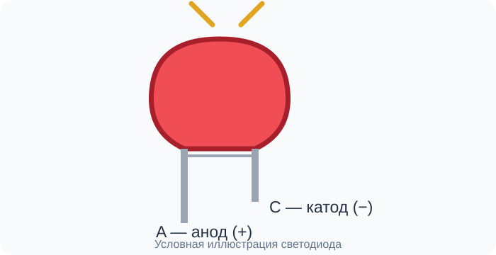
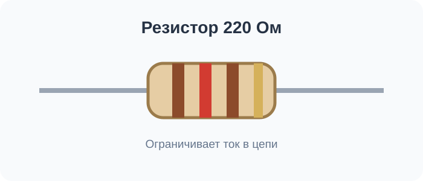
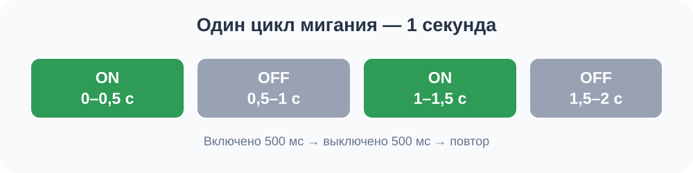

# Урок 1. Arduino: заставляем светодиод мигать

Материал рассчитан на первое знакомство с Arduino. Мы последовательно
соберём простое устройство, напишем программу, запустим её в Wokwi и
научимся искать типичные ошибки.

## 1. Что мы будем делать

Представь, что мы создаём маленький световой маяк. Arduino будет
включать светодиод, ждать, выключать его и повторять всё сначала.

В конце урока: - внешний светодиод будет мигать; - встроенный светодиод
платы будет мигать одновременно с ним; - в Serial Monitor появятся
сообщения `ON` и `OFF`.

## 2. Что такое Arduino



**Arduino** --- это плата, которая выполняет программу и управляет
подключёнными устройствами.

Например: - светодиодом --- управляет светом; - кнопкой --- получает
сигнал о нажатии; - датчиком температуры --- получает данные об
окружающей среде; - зуммером --- управляет звуком.

На плате есть микроконтроллер --- небольшой компьютер, который выполняет
программу. В этом уроке рассматриваем классические Arduino Uno R3 и Nano
на ATmega328P.

### Как работает устройство

1.  **Программа.** Мы пишем команды на компьютере.
2.  **Arduino.** Микроконтроллер выполняет команды.
3.  **Светодиод.** Получает управляющий сигнал и загорается.

Главная идея: мы пишем код, а Arduino выполняет его и управляет
компонентами.

## 3. Какие детали понадобятся

### 1. Плата Arduino Uno или Nano

Выполняет программу и управляет контактами. Контакт --- это точка
подключения провода к плате.

### 2. Красный светодиод (LED)



Показывает результат работы программы. У светодиода есть полярность:
анод `A` --- положительный вывод, катод `C` --- отрицательный.

### 3. Резистор на 220 Ом



Резистор ограничивает ток, чтобы защитить светодиод и выход платы.

### 4. Провода

Соединяют плату, светодиод и резистор в одну электрическую цепь.

Дополнительно понадобится браузер и симулятор
[Wokwi](https://wokwi.com/). Он позволяет собрать схему и проверить
программу без настоящей платы.

## 4. Как соединить компоненты

Запомним обозначения: - `D4` --- цифровой контакт Arduino, которым будем
управлять; - `GND` --- общий провод цепи; - `HIGH` и `LOW` --- два
состояния цифрового выхода.


Подключения выполняются в таком порядке:

1.  Соедини контакт `D4` с анодом `A` светодиода.
2.  Соедини катод `C` светодиода с одним выводом резистора.
3.  Соедини второй вывод резистора с `GND`.

Резистор можно поставить и между D4 и анодом --- главное, чтобы он был
включён последовательно в ту же цепь.

Почему это работает: 1. Arduino подаёт управляющий сигнал на D4. 2. Ток
проходит через светодиод. 3. Резистор ограничивает ток. 4. Цепь
возвращается к GND.

Если светодиод подключить наоборот, он может не загореться. Если забыть
резистор при реальной сборке, можно повредить компоненты.

> **Безопасность:** перед подключением проводов к настоящей плате
> отключи питание. Не соединяй D4 напрямую с 5V или GND. Для первого
> опыта безопаснее начать с симулятора.

## 5. Шаг первый. Создаём проект в Wokwi

1.  Открой [wokwi.com](https://wokwi.com/).
2.  Нажми **New Project** и выбери Arduino Uno.
3.  Добавь красный LED.
4.  Добавь резистор и укажи значение `220` Ом.
5.  Добавь провода и соедини контакты по схеме выше.
6.  Открой редактор кода `sketch.ino`.
7.  Вставь программу из следующего раздела.
8.  Нажми кнопку запуска симуляции --- зелёный значок Play.

Если у тебя Arduino Nano, выбери Nano. Для классических Uno R3 и Nano на
ATmega328P код этого урока одинаковый.

## 6. Шаг второй. Пишем программу

Сначала вставь весь код, а затем разберём его частями.

``` cpp
const int externalLedPin = 4;

void setup() {
  pinMode(LED_BUILTIN, OUTPUT);
  pinMode(externalLedPin, OUTPUT);
  Serial.begin(9600);
}

void loop() {
  digitalWrite(LED_BUILTIN, HIGH);
  digitalWrite(externalLedPin, HIGH);
  Serial.println("External LED: ON");
  delay(500);

  digitalWrite(LED_BUILTIN, LOW);
  digitalWrite(externalLedPin, LOW);
  Serial.println("External LED: OFF");
  delay(500);
}
```

Программа состоит из двух основных частей: подготовка и повторяющиеся
действия.

### Часть 1. Запоминаем номер контакта

``` cpp
const int externalLedPin = 4;
```

  Часть              Что означает
  ------------------ -----------------------------------------
  `const`            Значение нельзя изменить после создания
  `int`              Целое число
  `externalLedPin`   Имя, которое мы дали контакту
  `= 4`              Запоминаем номер контакта D4
  `;`                Завершаем инструкцию

Вместо того чтобы постоянно писать число `4`, используем понятное имя
`externalLedPin`. По нему видно, что контакт управляет внешним
светодиодом.

### Часть 2. Подготавливаем Arduino

``` cpp
void setup() {
  pinMode(LED_BUILTIN, OUTPUT);
  pinMode(externalLedPin, OUTPUT);
  Serial.begin(9600);
}
```

`setup()` выполняется один раз после запуска или сброса платы. Она
подготавливает устройство к работе.

**Команда 1**

``` cpp
pinMode(LED_BUILTIN, OUTPUT);
```

-   `pinMode` --- настройка режима контакта;
-   `LED_BUILTIN` --- обозначение контакта встроенного светодиода;
-   `OUTPUT` --- режим выхода: Arduino будет задавать сигнал.

**Команда 2**

``` cpp
pinMode(externalLedPin, OUTPUT);
```

Настраиваем D4 как выход для управления внешним светодиодом.

**Команда 3**

``` cpp
Serial.begin(9600);
```

Включаем последовательную связь с компьютером, чтобы отправлять
сообщения в Serial Monitor. Число `9600` --- скорость передачи данных. В
мониторе порта нужно выбрать такое же значение.

После этих команд подготовка закончена.

### Часть 3. Включаем светодиоды

``` cpp
void loop() {
  digitalWrite(LED_BUILTIN, HIGH);
  digitalWrite(externalLedPin, HIGH);
  Serial.println("External LED: ON");
  delay(500);
```

`loop()` --- функция, которая повторяется, пока плата работает.

1.  `digitalWrite(LED_BUILTIN, HIGH);` --- включает встроенный
    светодиод.
2.  `digitalWrite(externalLedPin, HIGH);` --- включает внешний светодиод
    на D4.
3.  `Serial.println("External LED: ON");` --- выводит сообщение
    `External LED: ON` в Serial Monitor. Команда `println` после
    сообщения переходит на новую строку.
4.  `delay(500);` --- ждёт 500 миллисекунд, то есть половину секунды.
    Пока программа ждёт, светодиоды остаются включёнными.

### Часть 4. Выключаем светодиоды

``` cpp
digitalWrite(LED_BUILTIN, LOW);
digitalWrite(externalLedPin, LOW);
Serial.println("External LED: OFF");
delay(500);
```

Команды выполняются по порядку:

1.  `LOW` --- выключаем встроенный светодиод.
2.  `LOW` --- выключаем внешний светодиод.
3.  Отправляем сообщение `External LED: OFF`.
4.  Ждём ещё 500 миллисекунд.

После завершения `loop()` Arduino запускает её снова. Поэтому мигание
продолжается.

Фигурные скобки `{` и `}` обозначают начало и конец блока команд.

## 7. Как программа работает по времени



Один полный цикл длится примерно одну секунду:

-   500 мс светодиоды включены;
-   500 мс светодиоды выключены.

`500 мс + 500 мс = 1000 мс = 1 секунда`.

## 8. Шаг третий. Запускаем и проверяем результат

После запуска симуляции проверь не только светодиод, но и сообщения
программы.

В Serial Monitor должны повторяться строки:

``` text
External LED: ON
External LED: OFF
External LED: ON
External LED: OFF
```

Проверь по порядку:

-   [ ] Встроенный светодиод мигает.
-   [ ] Внешний светодиод мигает одновременно со встроенным.
-   [ ] Светодиоды горят примерно полсекунды и столько же не горят.
-   [ ] Сообщения `ON` и `OFF` чередуются.
-   [ ] В Serial Monitor выбрана скорость `9600`.

Если всё совпало, программа работает правильно.

## 9. Если что-то не работает

Не переписывай сразу всю программу. Сначала определи симптом.

### Встроенный светодиод мигает, внешний --- нет

1.  Проверь, что в коде указано `externalLedPin = 4`.
2.  Проверь соединение контакта D4 со светодиодом.
3.  Убедись, что анод A подключён к D4, а катод C --- через резистор к
    GND.
4.  Убедись, что резистор включён последовательно.

### Оба светодиода не мигают

1.  Проверь, запущена ли симуляция.
2.  Убедись, что в коде есть `setup()` и `loop()`.
3.  Проверь, нет ли ошибок компиляции.
4.  Убедись, что в `setup()` есть обе команды `pinMode`.

### Светодиоды мигают, но сообщений нет

1.  Открой Serial Monitor.
2.  Проверь наличие `Serial.begin(9600);`.
3.  Установи скорость монитора `9600`.
4.  Проверь, что команды `Serial.println()` не удалены.

### Программа не запускается из-за ошибки

1.  Проверь, что у каждой открывающей `{` есть закрывающая `}`.
2.  Проверь точки с запятой `;` в конце команд.
3.  Убедись, что скопировал код целиком.
4.  Прочитай первую ошибку компилятора: следующие сообщения могут быть
    следствием первой ошибки.

При работе с настоящей платой отключи питание перед проверкой
соединений. Успешная симуляция не гарантирует безопасность физической
схемы.

## 10. Эксперимент: меняем скорость мигания

Найди в коде обе строки:

``` cpp
delay(500);
```

Измени оба значения на `1000`:

``` cpp
delay(1000);
```

Что произойдёт: - светодиоды будут включены примерно одну секунду; -
затем выключены примерно одну секунду; - полный цикл займёт около двух
секунд.

Попробуй также значение `200`. Светодиоды будут переключаться быстрее.

**Правило эксперимента:** меняй одну характеристику за раз и наблюдай за
результатом.

## 11. Что нужно запомнить

  Команда или термин   Простое объяснение
  -------------------- -----------------------------------------
  Arduino              Плата, выполняющая программу
  Скетч                Программа для Arduino
  `setup()`            Подготовка, выполняется один раз
  `loop()`             Действия, которые постоянно повторяются
  `pinMode()`          Настройка контакта
  `OUTPUT`             Контакт работает как выход
  `digitalWrite()`     Установка состояния выхода
  `HIGH`               Высокий логический уровень
  `LOW`                Низкий логический уровень
  `delay(500)`         Пауза на половину секунды
  `Serial.println()`   Отправка сообщения в монитор
  `GND`                Общий провод цепи

## 12. Домашнее задание

1.  Создай проект в Wokwi и добейся правильной работы двух светодиодов.
2.  Измени задержку с `500` на `1000` миллисекунд и проверь результат.
3.  Верни задержку на `500` и попробуй установить `200` миллисекунд.
4.  Подготовь скриншот работающей схемы и Serial Monitor.
5.  Ответь письменно:
    -   зачем нужны `setup()` и `loop()`?
    -   почему в реальной схеме используется резистор?

**Критерий выполнения:** схема работает, сообщения соответствуют
состоянию светодиодов, а ты можешь объяснить назначение основных команд.

Следующий шаг --- подключить кнопку, чтобы Arduino не только управляла
светодиодом, но и реагировала на действия пользователя.
